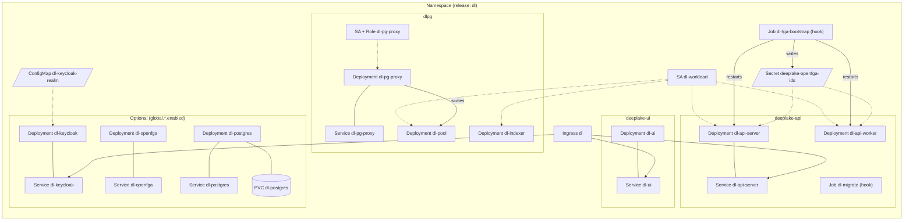
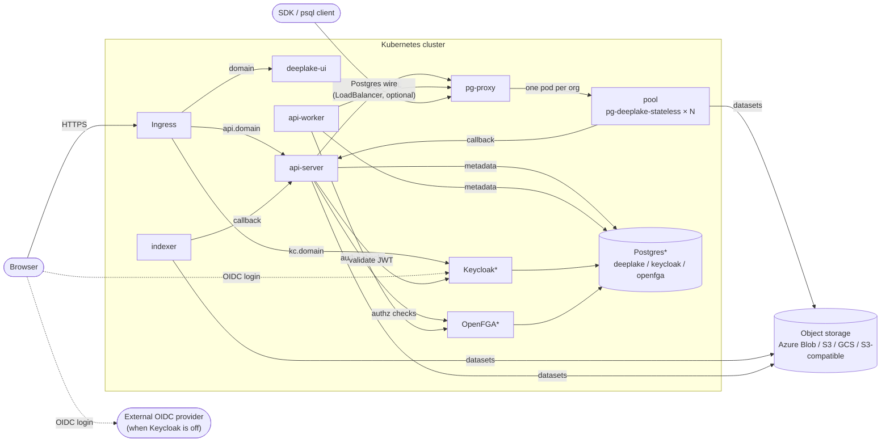

# deeplake-platform

Helm chart for self-hosted Deep Lake. Installs the control-plane API, the web
UI, and the pg-deeplake data plane into a customer's own Kubernetes cluster.

Azure/AKS is the primary target; AWS/EKS and GCP/GKE share the same chart via
`global.cloud`. `global.cloud: s3` targets any other cluster whose object
storage is an S3-compatible endpoint with a static key (Ceph RGW, MinIO, NRP
Nautilus); see `values-s3.yaml`.

## Layout

```
deeplake-platform/
├── Chart.yaml              # chart version IS the platform release
├── values.yaml             # the customer-facing contract (everything is under `global`)
├── values-azure.yaml       # per-cloud overlays
├── values-aws.yaml
├── values-gcp.yaml
├── values-s3.yaml          # S3-compatible endpoint + static key (Ceph, MinIO, NRP)
├── docs/install.md         # setup guide: prerequisites, install, verify
└── charts/
    ├── deeplake-common/    # library chart — shared helpers, renders nothing
    ├── deeplake-api/       # api-server, api-worker, migration hook
    ├── deeplake-ui/        # Next.js UI + runtime config
    └── dlpg/               # pg-proxy, stateless pool, indexer
```

## What gets deployed

Names below assume release name `dl` (`<release>-<component>`). Everything is
`ClusterIP`; traffic enters only through the Ingress, plus `pg-proxy` if you
set `dlpg.proxy.service.type: LoadBalancer`.

### Always installed

| Workload | Kind | Image | Replicas | Service | Storage |
| --- | --- | --- | --- | --- | --- |
| `dl-ui` | Deployment | `activeloopai/deeplake-ui` | 2 | `dl-ui:80` | - |
| `dl-api-server` | Deployment | `activeloopai/deeplake-api` (`server-*`) | 2 | `dl-api-server:80` | `emptyDir` /tmp |
| `dl-api-worker` | Deployment | `activeloopai/deeplake-api` (`worker-*`) | 1 | - | `emptyDir` /tmp |
| `dl-pg-proxy` | Deployment | `activeloopai/pg-proxy` | 2 | `dl-pg-proxy:5432,8080` | - |
| `dl-pool` | Deployment | `activeloopai/pg-deeplake-stateless` | managed by `pg-proxy` | - (pods addressed directly) | `emptyDir` pgdata |
| `dl-indexer` | Deployment | `activeloopai/pg-deeplake-stateless` | 1 | - | `emptyDir` pgdata |
| `dl-migrate` | Job (hook) | `activeloopai/deeplake-api` (`setup-*`) | - | - | - |
| `dl-fga-bootstrap` | Job (hook) | `curl/curl` | - | - | writes `deeplake-openfga-ids` Secret |

Supporting objects: Ingress `dl` (`<domain>` → `dl-ui`, `api.<domain>` →
`dl-api-server`, `kc.<domain>` → `dl-keycloak` when bundled), ServiceAccount
`dl-workload` (workload identity, shared by API and dlpg pods), ServiceAccount
+ Role `dl-pg-proxy` (patch pods/deployments, leases for leader election),
ServiceAccount + Role `dl-fga-bootstrap` (get/create/patch Secrets, patch the
two API Deployments), ConfigMap `dl-keycloak-realm` (when
`global.auth.provider: oidc`).

`dl-migrate` runs `pre-install,pre-upgrade` against an external database, and
`post-install,post-upgrade` when the bundled Postgres is enabled (it cannot
exist before the release). `dl-fga-bootstrap` runs `post-install,pre-upgrade`.

### Optional, off by default

| Toggle | Adds |
| --- | --- |
| `global.postgres.enabled` | Deployment + Service `dl-postgres` (`postgres:18`), PVC `dl-postgres` (32Gi), ConfigMap `dl-postgres-init` (creates `deeplake`, `keycloak`, `openfga` DBs) |
| `global.keycloak.enabled` | Deployment + Service `dl-keycloak` (`keycloak:26.7.0`, 1 replica), Ingress rule for `kc.<domain>` |
| `global.openfga.enabled` | Deployment + Service `dl-openfga` (`openfga:v1.8.5`, `migrate` init container) |
| `ingress-nginx.enabled` | the `ingress-nginx` 4.12.1 subchart |
| `dlpg.pool.canary.enabled` | Deployment `dl-pool-canary` (Activeloop-internal) |
| `dlpg.pgPilot.enabled` | Role/RoleBinding `pg-pilot` for in-place pod resize (K8s ≥ 1.33) |
| `*.serviceMonitor` / `dlpg.metrics.podMonitor` | Prometheus Operator `ServiceMonitor` / `PodMonitor` |

### Not managed by the chart

You provide these; the chart only references them:

- Object storage bucket/container at `global.storage.rootPath`, and the cloud
  identity (or static S3 key) that can read and write it.
- Secrets `global.secrets.api`, `global.secrets.dlpg`, Keycloak admin, OpenFGA
  token, image pull secret, TLS secret.
- Control-plane Postgres, OIDC provider and OpenFGA when the bundled ones are off.
- DNS records and the ingress controller / cert-manager.

### Resource diagram



### Platform diagram



`*` bundled only when `global.<name>.enabled: true`; otherwise external.

## Install

Full walkthrough in [docs/install.md](docs/install.md) — object storage,
workload identity, secrets, DNS, and a verification checklist. Once the
prerequisites are in place:

```bash
helm install deeplake oci://quay.io/activeloopai/charts/deeplake-platform \
  --version 0.1.3 \
  --namespace deeplake --create-namespace \
  -f values-azure.yaml \
  -f my-values.yaml
```

The chart pulls anonymously. `deeplake-api` and `deeplake-ui` are private images, so you also
need a pull secret — `global.imagePullSecrets` — created from credentials we
issue you. Everything else (`deeplake-ui`, `pg-deeplake-stateless`, `pg-proxy`)
pulls anonymously too.

Workload identity is the step to get right: a missing or mismatched federated
credential makes `pg_deeplake` abort the Postgres backend on the first
storage-touching statement, rather than returning an error. With
`global.cloud: s3` there is no identity to federate: the pods read a static key
from the Secret named in `global.storage.s3.credentialsSecret`.

KeyCloak realm ConfigMap renders whether or not Keycloak is bundled, so a installation
running it's own Keycloak can import the same realm:

```bash
kubectl get cm <release>-keycloak-realm -o jsonpath='{.data.realm\.json}' > realm.json
# then: admin console -> Create realm -> Browse -> realm.json
```

Import happens once, at first startup, and skips a realm that already exists —
edit clients in the admin console after that, not by reinstalling.

**The chart never creates a secret.** You supply Secret names via
`global.secrets.*`. Generate them yourself or sync them with External Secrets
Operator from Key Vault / Secrets Manager.

## Notes

- **"Ask AI" query suggestion needs `OPENAI_API_KEY`.** Not set by the chart;
  the endpoint 404s without it. Billing endpoints 404 by design.
- **The OpenFGA model ships with the chart and is applied on every upgrade.**
  `deeplake-api` checks the `workspace` relations `admin`, `writer`, `viewer`
  and `blocked`; a store still on the older model fails every workspace request.
  The bootstrap Job runs as a `pre-upgrade` (and `post-install`) hook, so on
  `helm upgrade` the current model is written to the existing store and its id
  patched into the `global.openfga.bootstrap.secretName` Secret *before* new
  API pods start. Writing a model only adds to the store: existing tuples stay
  valid and the previous API keeps working on it. The Job skips the write when
  the Secret's `FGA_MODEL_SHA256` already matches the shipped model. Pods read
  the id at start, so when the Job writes a new model it also restarts the API
  server and worker Deployments (it patches a pod-template annotation; RBAC is
  limited to get/patch on those two Deployments). On an upgrade that also
  changes the API image this can roll the pods once before Helm rolls them again.
- **`dlpg.pgPilot` requires Kubernetes ≥ 1.33** with `InPlacePodVerticalScaling`
  for the `pods/resize` subresource. Off by default; verify before enabling.
- **The device grant always shows an approval page.** `consentRequired` is false
  on both clients, but Keycloak still renders a confirm step for the device flow
  — the user is approving the device, not the client's scopes. `hivemind` users
  see it after login. This is correct OAuth behaviour, not a misconfiguration.
- **Bundled Keycloak runs a single replica.** Clustering it means configuring
  jgroups discovery; `keycloak.replicas > 1` is not wired up.
- **Users need first and last name.** Keycloak forces an "Update Account
  Information" step otherwise, which stalls the device flow. Self-registration
  collects both; users created through the admin API must set them too.
- **Pool sizing needs review per customer.** Requests are 2Gi/0.5cpu but limits
  are 32Gi/8cpu, and the tail genuinely reaches it. Nodes must be able to
  schedule a pod at the limit.

The chart has no remote dependencies and renders with no network access.
